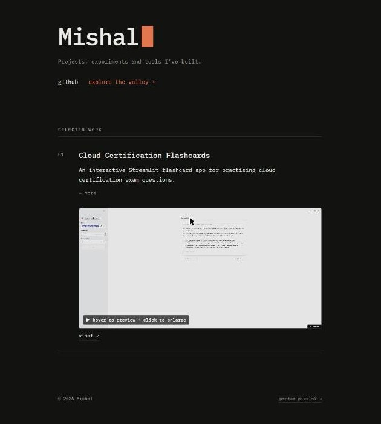
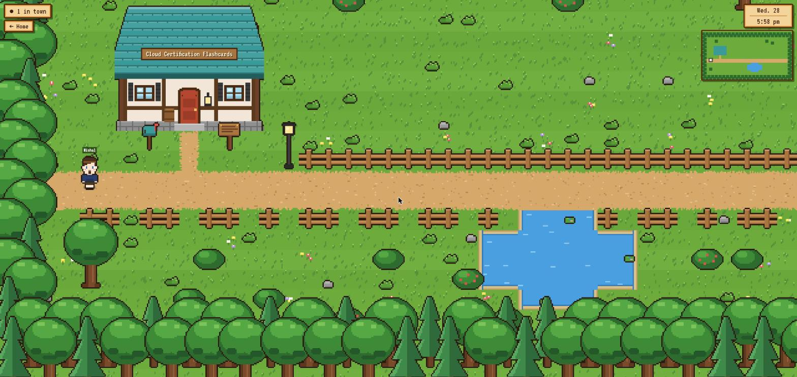
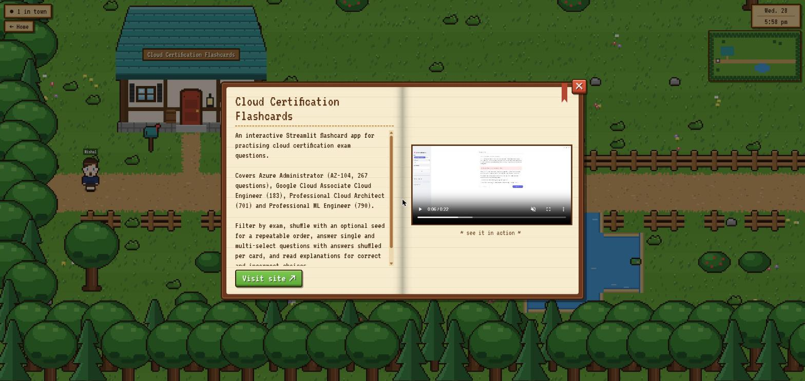

# Mishal's Portfolio

**Live:** [personal-portfolio-tc9w.onrender.com](https://personal-portfolio-tc9w.onrender.com/) · **Valley:** [/valley](https://personal-portfolio-tc9w.onrender.com/valley/)

> Hosted on Render's free tier: if it's been idle, the first load can take up to a minute while the server wakes up.

My personal portfolio, in two flavours built from the same project data:

- **`/`**: a minimal, typewriter-style page listing my work.
- **`/valley/`**: a multiplayer pixel-art town in the spirit of Stardew Valley. Every house is a project; walk up to its signpost and a book opens with the write-up and a demo video. Other visitors walk around with you in real time.

<p align="center">
  
  
</p>
<p align="center">
  
</p>

## Features

**Home page**
- Typewriter heading, monospace type, light and dark themes that follow the system
- Project videos stay still until you hover; click to watch full-size in a lightbox

**The valley**
- Top-down town drawn entirely in code: no image assets, every sprite is `fillRect` plus an outline pass
- One house per project, generated from its title (walls, windows, shutters, door, awning, chimney, roof pitch, ivy...), so it looks the same for every visitor
- Signpost at each door opens a book: scrollable description on the left, demo video on the right, "Visit site" button
- Live multiplayer over WebSocket: visitor count, name tags, minimap, smooth movement
- Random characters built from 15 traits (skin, hair style and colour, eyes, facial hair, clothes, accessories...), with a reroll button on the title screen
- Loading screen that waits for the backend (handles free-tier cold starts)

## Tech stack

| | |
|---|---|
| Frontend | [Vite](https://vite.dev), TypeScript, Canvas 2D (no framework, no game engine) |
| Backend | Node.js `http` + [`ws`](https://github.com/websockets/ws), one process serving the site and the live socket |
| Content | My public GitHub repos, read from the GitHub API by the server and cached |

Runtime dependencies: just `ws`.

## Getting started

Requires Node.js 20.11 or newer.

```bash
npm install
npm run dev        # http://localhost:5173 (live socket runs inside Vite)
```

Production:

```bash
npm run build      # type-check + bundle to dist/
npm start          # serves dist/ and the socket on $PORT (default 8080)
```

| Script | |
|---|---|
| `npm run dev` | Dev server with hot reload and the multiplayer socket |
| `npm run build` | Type-check and build both pages |
| `npm start` | Production server |
| `npm test` | Unit tests: HTTP range handling and GitHub repo → project mapping |

## Adding a project

Projects come straight from my **public GitHub repos**, so adding one means publishing a repo. Each repo becomes a
row on the home page and a house in the valley.

| On GitHub | Becomes |
|---|---|
| About → **Description** `Name — what it does` | Title `Name`, description `what it does` (an em dash, en dash or `\|` splits them). Without a separator, the title is the repo name tidied up (`my-cool-app` → "My Cool App") |
| About → **Website** | "visit" / "Visit site" link (falls back to the repo) |
| `demo.mp4` (or any `.mp4`/`.webm`) in the **repo root** | Preview video on the home page and in the valley's book |
| The repo itself | "code" link |

Skipped automatically: forks, archived repos, the `<username>/<username>` profile repo, and this site's repo.

The server fetches everything once, on its first request, and serves it from memory after that, so visitors never touch
GitHub's rate limit. **New or edited repos show up after the server restarts** (any deploy, or Render's free tier
waking up from idle). Videos are streamed through the server (`/api/video/<repo>`) because GitHub serves raw files as
`application/octet-stream`, which Safari won't play.

| Env var | Default | |
|---|---|---|
| `GITHUB_USER` | `zayn0001` | Whose repos to list |
| `PORTFOLIO_REPO` | `personal-portfolio` | This site's repo, excluded from the list |
| `GITHUB_TOKEN` | – | Optional. Raises the API limit from 60 to 5,000 requests/hour |

## Project structure

```
index.html          home page          → src/home.ts, src/home.css
valley/index.html   the valley         → src/valley.ts (+ world.ts, sprites.ts, book.ts, live.ts, style.css)
src/projects.ts     fetches /api/projects, shared by both pages
server/             production server: static files (with range requests), GitHub projects + video proxy
                    (projects.js), live socket (live.js), tests
```

## Deployment

The valley's multiplayer needs a running Node process, so deploy to something like Render, Railway or Fly.io:

- **Build command:** `npm install && npm run build`
- **Start command:** `npm start`

- **Health check path:** `/healthz` (returns `{"status":"ok"}`)

The server reads `$PORT`. Visitor state is in memory, so a restart just makes everyone reconnect.

To host the pages statically elsewhere (e.g. Netlify) and run only the socket on a Node host, build with
`VITE_WS_URL=wss://your-node-host/live npm run build`.

## License

[MIT](LICENSE)
